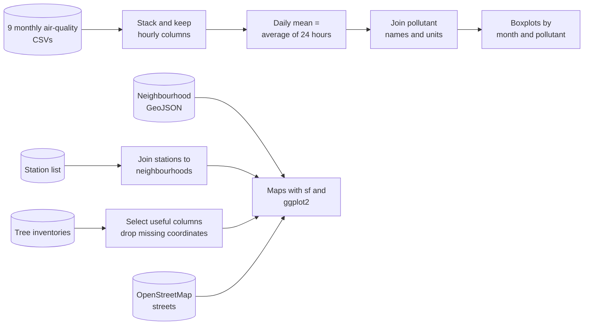
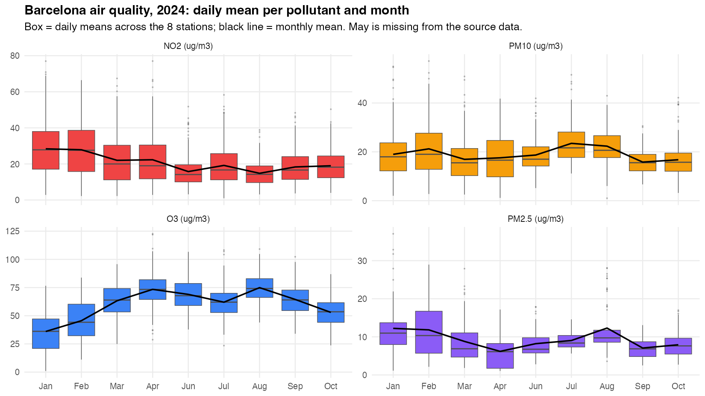
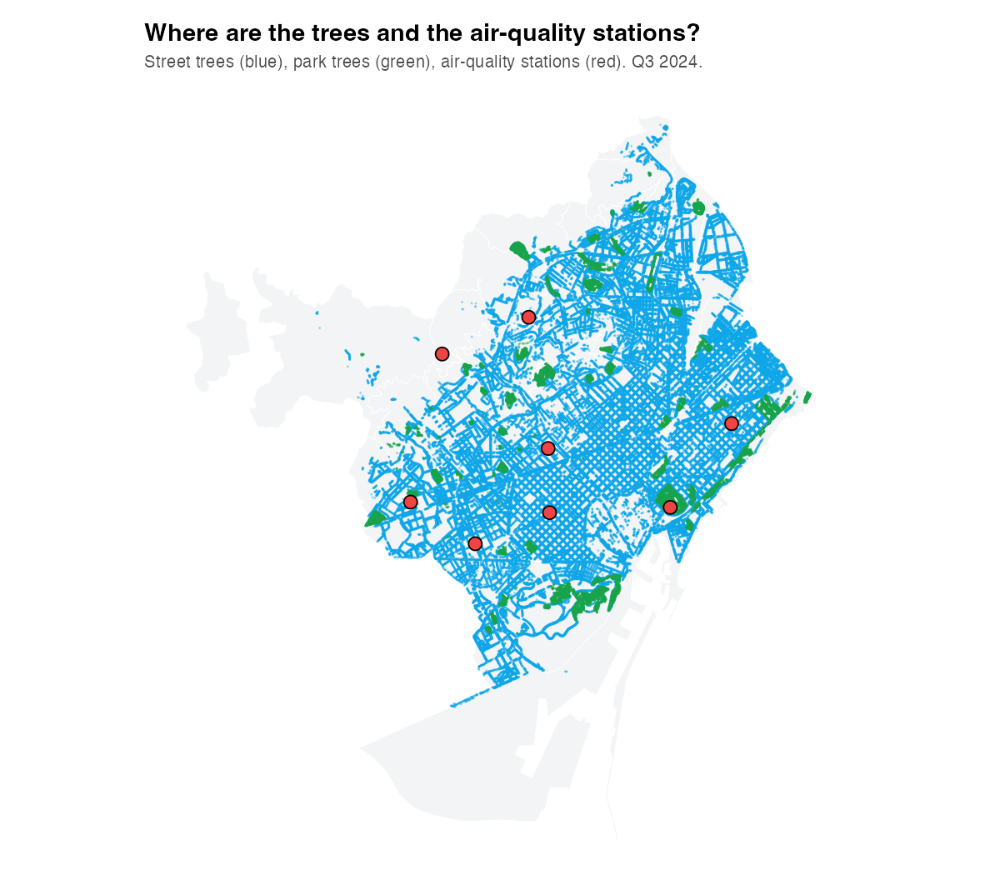
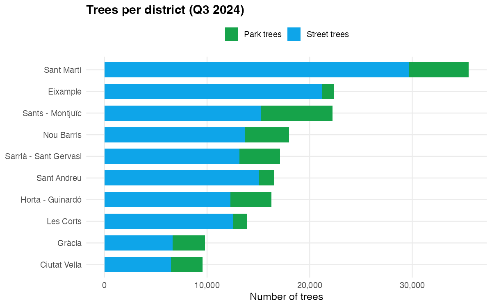

<div align="center">

# 🌳 Air Quality and Urban Trees in Barcelona
### A Spatial Data Analysis in R

**Putting Barcelona's pollution sensors and its 180,000 trees on the same map, and watching how the city's air changes through the year, using open data.**


*Final project · BI & Data Analytics · La Salle – Universitat Ramon Llull · 2024–25*
*Authors: Mauricio Valdez Fusté & Javier Gonzalo*

</div>

---

## 📑 Contents

1. [The project in one minute](#-the-project-in-one-minute)
2. [The data](#-the-data)
3. [How the analysis works](#-how-the-analysis-works)
4. [Results and demonstration](#-results-and-demonstration)
5. [Limitations and honest caveats](#-limitations-and-honest-caveats)
6. [Key takeaways](#-key-takeaways)
7. [Glossary](#-glossary-for-non-specialists)
8. [Run it yourself](#%EF%B8%8F-run-it-yourself)
9. [Project structure](#-project-structure)
10. [References and data credits](#-references-and-data-credits)

---

## 📌 The project in one minute

Cities measure their air with a handful of expensive sensors, and plant their trees by the tens of thousands. This project asks a simple question: **where are the sensors and the trees relative to each other, and what does the air they measure look like through the year?**

| | |
|---|---|
| **Question** | How are Barcelona's air-quality stations and trees distributed across the city, and how do pollutant levels change month by month? |
| **Data** | Open data from the city: hourly pollutant readings (Jan–Oct 2024), station locations, and quarterly tree inventories for streets and parks. |
| **Method** | Cleaning and joining many CSV files with `dplyr`, then spatial plots with `sf`, `ggplot2`, `osmdata` and `leaflet`. |
| **Output** | Monthly pollutant charts, and maps combining sensors, street trees, park trees, neighbourhoods and population. |
| **Tooling** | R, the tidyverse and the `sf` spatial toolkit. |

| 📡 8 air-quality stations | 🌳 181,182 tree records (Q3 2024) | 📅 9 months of hourly data | 🏙️ 10 districts |
|:--:|:--:|:--:|:--:|

---

## 🗄 The data

Everything comes from open sources. No data was collected by the authors.

| Dataset | What it contains | Size |
|---|---|---|
| **Air quality** (monthly files, Jan–Oct 2024, no May) | One row per station, pollutant and day, with **24 hourly values** (`H01`–`H24`) | 17,858 rows |
| **Pollutant lookup** | Code → pollutant name and unit (NO₂, PM10, O₃, SO₂, CO…) | 21 pollutants |
| **Air-quality stations** | Name, longitude, latitude, neighbourhood of each station | 8 stations |
| **Street trees** (3 quarterly snapshots, 2024) | One row per tree: species, address, planting date, neighbourhood, district, coordinates | ≈ 146,000 trees per quarter |
| **Park trees** (3 quarterly snapshots, 2024) | The same fields for trees inside green areas | ≈ 35,000 trees per quarter |
| **Neighbourhood boundaries** (GeoJSON) | Polygons of Barcelona's 73 neighbourhoods | 73 polygons |
| **Population by territory** | Residents per neighbourhood and district (July 2024) | used for the population map |
| **OpenStreetMap** | The city's street network, downloaded on the fly with `osmdata` | live query |

> **A detail that matters:** the three quarterly tree files are *snapshots of the same inventory*, not three different sets of trees. Across the three quarters there are 440,124 street-tree rows but only **147,863 distinct trees** (and 36,954 distinct park trees), so stacking the files would triple-count the city's trees.

---

## 🔧 How the analysis works



The final script ([`R/barcelona_air_quality_trees.R`](R/barcelona_air_quality_trees.R)) works in six steps:

1. **Load** the nine monthly air-quality files and the tree, station and population tables.
2. **Clean and join:** stack the months, keep the 24 hourly columns, and attach pollutant names from the lookup table.
3. **Summarise:** average the 24 hourly values into one daily figure per station and pollutant.
4. **Chart the evolution** of each pollutant (NO, NO₂, NOx, PM10 and PM2.5, O₃, SO₂, CO, black carbon) with monthly boxplots and a smoothed trend.
5. **Map the trees and sensors:** street trees, park trees and the 8 stations over the neighbourhood polygons and over the OpenStreetMap street network.
6. **Map the population** per neighbourhood as a choropleth, and join stations to their neighbourhood.

A representative piece, turning hourly readings into a daily mean and attaching pollutant names:

```r
A_ToT  <- rbind(A_E, A_F, A_M, A_A, A_J, A_J2, A_A2, A_S, A_O)   # stack the monthly files
MEAN_T <- rowSums(A_ToT[, c(5:28)]) / 24                          # 24 hourly columns → daily mean
A_ToT  <- left_join(cbind(A_ToT, MEAN_T), Cont)                   # add pollutant name and unit
```

---

## 🎬 Results and demonstration

> The figures below were **re-generated from the project data** with [`R/make_figures.R`](R/make_figures.R), a clean, runnable version of the original plots, so you can reproduce each one.

### 1 · The air changes through the year



| Pollutant | Pattern in 2024 | Monthly mean |
|---|---|---|
| **NO₂** (traffic) | Highest in winter, lowest in summer | 28.4 µg/m³ in January → 14.8 in August (about half) |
| **O₃** (ozone) | The mirror image: peaks when it is hot and sunny | 36.0 µg/m³ in January → 74.9 in August (roughly double) |
| **PM10** | Fairly flat, with a bump in July–August | between 15.8 and 23.5 µg/m³ |
| **PM2.5** | Higher in winter and again in August | between 6.2 and 12.3 µg/m³ |

The opposite seasonal shape of NO₂ and ozone is a well-known feature of urban air: ozone is produced from traffic emissions by sunlight, so it rises when the sun is strongest, while NO₂ builds up in the cold, still air of winter.

### 2 · Where the sensors and the trees are



The 8 stations (red) are spread across the built-up part of the city, where the street-tree network (blue) is densest, and none sits on the outskirts. The park trees (green) form compact blocks, in contrast with the long blue lines of the street trees.

### 3 · Trees per district



**Sant Martí** has the most tree records (about 35,500), with Eixample and Sants–Montjuïc next. Ciutat Vella and Gràcia have the fewest, and they are among the smallest districts by area.

### What the original script also produces
- Per-pollutant charts for NO, NOx, SO₂, CO and black carbon, each with a smoothed trend.
- A map of street trees on the real OpenStreetMap road network.
- A choropleth of the population of each neighbourhood.
- A neighbourhood map with each station and a label, which is computationally heavy.

---

## 🔍 Limitations and honest caveats

A good project says what it did **not** show:

1. **The analysis is exploratory, not inferential.** The project places the sensors and the trees on the same map and charts the pollutants, but it does not test statistically whether neighbourhoods with more trees have cleaner air. That would be the natural next step.
2. **Only 8 stations.** Eight points cannot represent a city of 73 neighbourhoods, and the stations are not placed at random, so any comparison between neighbourhoods would be fragile.
3. **May is missing** from the source data (nine monthly files, January to October), which leaves a gap in every monthly chart.
4. **Tree counts are not tree density.** Sant Martí has the most trees partly because it is large; the project does not divide by area or population.
5. **The three quarterly tree files are snapshots of the same trees**, so stacking them overcounts (see [The data](#-the-data)).
6. **Missing hours are handled bluntly.** The original script drops any row where one of the 24 hourly values is missing (`complete.cases`), which can bias monthly means. The regenerated figures use the mean of the available hours instead, so their numbers can differ slightly from the original script's.
7. **The final script is not fully self-contained.** `R/barcelona_air_quality_trees.R` uses two objects (`DataTGA` and `DataTSTR`) that are built only in the earlier draft [`R/draft_FP.R`](R/draft_FP.R), and the population table it reads (`Taula estadística.csv`) is not in the data archive. See [Run it yourself](#%EF%B8%8F-run-it-yourself).
8. **Slow, networked steps.** Downloading the OpenStreetMap street network and drawing every street is slow, and the labelled neighbourhood map is heavy, as the script itself warns.

**Natural next steps:** compute trees per km² and per resident; relate tree density near each station to its pollutant levels with a proper model; add the missing month; adjust for traffic, which is the main driver of NO₂.

---

## 🔬 Key takeaways

1. **Seasonality dominates.** Across a year, month-to-month change in pollutants is larger than most differences you would see between places.
2. **Different pollutants tell different stories.** NO₂ follows traffic and the cold; ozone follows sunlight.
3. **Spatial data makes patterns visible.** Putting sensors, trees and neighbourhoods on one map shows at a glance where the city is measured.
4. **Know your data.** Quarterly snapshots, missing months and hourly gaps change the numbers, so they must be checked before any conclusion.
5. **Reproducibility matters.** A script that depends on an unsaved session cannot be rerun, which is why the figures here come from a clean script.

---

## 📖 Glossary for non-specialists

| Term | Plain-English meaning |
|---|---|
| **Open data** | Information a public body publishes for anyone to reuse. |
| **NO₂ (nitrogen dioxide)** | A gas mainly from vehicle engines; a key urban pollutant. |
| **PM10 / PM2.5** | Tiny airborne particles, at most 10 or 2.5 micrometres wide. The smaller ones reach deeper into the lungs. |
| **O₃ (ozone)** | At ground level a pollutant formed by sunlight acting on traffic emissions. |
| **µg/m³** | Micrograms of pollutant per cubic metre of air. |
| **Boxplot** | A chart showing the middle half of the values as a box, the typical value as a line, and unusual values as dots. |
| **Choropleth** | A map where each area is coloured by a value, such as population. |
| **`sf`** | The R package for working with geographic shapes and coordinates. |
| **GeoJSON** | A file format that stores geographic shapes, here the neighbourhood boundaries. |
| **OpenStreetMap** | A free, community-built map of the world. |
| **Snapshot** | A copy of a dataset at one moment, here one quarter. |

---

## ▶️ Run it yourself

**Requirements:** R 4.x and these packages: `tidyverse`, `sf`, `osmdata`, `leaflet`, `ggmap`, `readr`, `dplyr`, `ggplot2`. You need an internet connection (neighbourhood boundaries and the street network are downloaded). [`7-zip`](https://www.7-zip.org) or `bsdtar` is needed to unpack the data.

```bash
git clone https://github.com/datamauriciovaldez/air-quality-and-urban-trees-in-barcelona-a-spatial-data-analysis-in-r.git
cd air-quality-and-urban-trees-in-barcelona-a-spatial-data-analysis-in-r

# 1. unpack the data (about 160 MB once extracted)
7z x data/Datos.7z -odata            # or: bsdtar -xf data/Datos.7z -C data
for z in data/Datos/Trees*/*.zip; do unzip -o "$z" -d "$(dirname "$z")"; done

# 2. re-generate the figures
Rscript R/make_figures.R
```

```r
install.packages(c("tidyverse", "sf", "osmdata", "leaflet", "ggmap"))
```

> **About the original analysis script.** `R/barcelona_air_quality_trees.R` is the authors' final script, with the absolute paths on their computers replaced by relative `data/Datos/...` paths. To run it end to end, first run the data-loading part of `R/draft_FP.R` (which defines `DataTGA` and `DataTSTR`), and add the population table `Taula estadística.csv` from the Barcelona statistics portal to `data/Datos/Population and Size/`. `R/make_figures.R` has none of these requirements.

---

## 🗂 Project structure

```
.
├── R/
│   ├── barcelona_air_quality_trees.R   # final analysis script (authors' original)
│   ├── draft_FP.R                      # earlier draft, defines DataTGA / DataTSTR
│   └── make_figures.R                  # clean script that regenerates every figure below
├── LICENSE                             # MIT, code only
├── data/
│   ├── Datos.7z                        # raw open data: air quality, trees, stations (≈ 160 MB unpacked)
│   └── qualitat_aire_contaminants.csv  # pollutant code → name and unit
├── assets/                             # figures used in this README
└── README.md
```

---

## 📖 References and data credits

- **Open Data BCN**, Ajuntament de Barcelona: hourly air quality (*Qualitat de l'aire*), air-quality stations, and the street and park tree inventories (*Arbrat viari* and *Arbrat parcs*). <https://opendata-ajuntament.barcelona.cat>
- **bcn-geodata** (`martgnz`): neighbourhood boundaries as GeoJSON. <https://github.com/martgnz/bcn-geodata>
- **OpenStreetMap contributors**: street network, via the `osmdata` package. © OpenStreetMap, ODbL.
- Pebesma, E. (2018). *Simple Features for R: Standardized Support for Spatial Vector Data*. The R Journal. The `sf` package.

The data belong to their publishers and are used here for educational purposes; please check each source's licence and give credit before reusing them.

## 📄 License

The **code** is released under the [MIT License](LICENSE). The **data** in `data/` come from the sources above and keep their own licences; they are not covered by the MIT License.

---

<div align="center">

Made by **Mauricio Valdez Fusté** & **Javier Gonzalo** · BI & Data Analytics · La Salle URL

</div>
